# Automated Real-Time Climber Readiness Detection in Speed Sport Climbing Using Computer Vision

## Overview

This project presents an automated computer-vision system for determining whether a speed climber is ready to start a climb.

The system evaluates three primary conditions:

1. Required safety equipment is present.

2. The climber's hands and feet are positioned on the prescribed starting holds.

3. The detected starting configuration remains stable for the required temporal condition.

The system combines YOLO-based object detection and segmentation, MediaPipe Pose estimation, geometric reasoning, temporal validation, and a web-based interface to produce a final `READY` or `NOT READY` state.

---

## System Overview

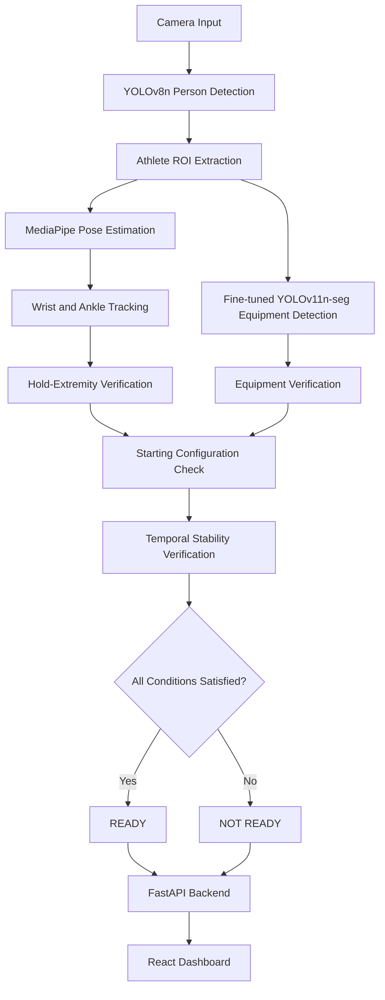
<br>

# Methodology

The system follows a hierarchical computer-vision pipeline consisting of multiple processing stages.

<p align="center">
  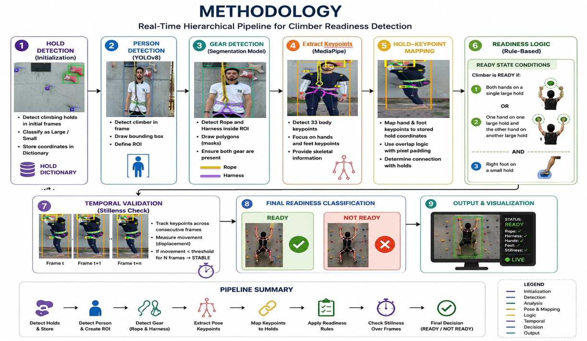
</p>

<p align="center"><em>Figure: Overall methodology of the automated real-time climber readiness detection system.</em></p>
<br>

## 1. Person Detection

The input camera frame is first processed using the **pretrained YOLOv8n model** to detect the person in the scene.

The standard pretrained model is used directly for person detection and is **not fine-tuned on the project datasets**.

The detected person is used to extract an athlete-specific region of interest (ROI), reducing unnecessary background information for subsequent processing stages.

---
<br>

## 2. Safety Equipment Segmentation

The athlete ROI is processed using a **YOLOv11n-seg model fine-tuned on the project's safety-equipment dataset**.

The model is trained to identify the following classes:

* `Rope`
* `Harness`

The segmentation output is used to verify the presence of the required rope and harness.

<br>

<table align="center">
  <tr>
    <td align="center" valign="middle">
      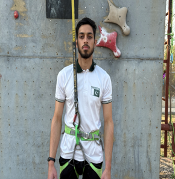
    </td>
    <td align="center" valign="middle">
      <strong style="font-size: 28px;">➜</strong>
    </td>
    <td align="center" valign="middle">
      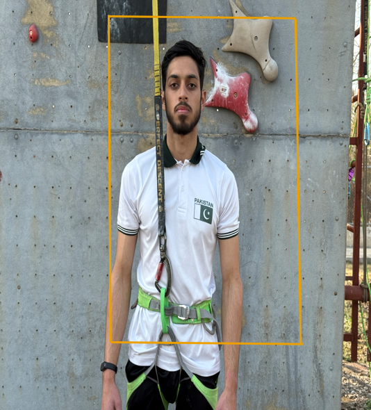
    </td>
    <td align="center" valign="middle">
      <strong style="font-size: 28px;">➜</strong>
    </td>
    <td align="center" valign="middle">
      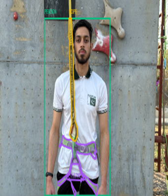
    </td>
  </tr>
</table>

<p align="center"><em>Figure: Progression from person detection to safety-equipment segmentation and verification.</em></p>

---
<br>

## 3. Pose Estimation

**MediaPipe Pose** is used to estimate human body landmarks within the detected athlete region.

Relevant landmarks include:

* Left wrist

* Right wrist

* Left ankle

* Right ankle

These landmarks provide the spatial positions required for verifying the climber's starting configuration.

---
<br>

## 4. Hold Detection

A **YOLOv8n model fine-tuned on the project's climbing-hold dataset** is used to detect the relevant starting holds on the climbing wall.

The hold dataset contains two classes:

* `hold_large`
* `hold_small`

The fine-tuned model provides the regions of the relevant holds used by the starting-position verification component.

---
<br>

## 5. Hold–Extremity Verification

The detected wrist and ankle positions from MediaPipe Pose are compared with the detected hold regions using geometric rules.

The system evaluates whether the required extremities are positioned on the prescribed starting holds.

This combines the outputs of:

* Fine-tuned YOLOv8n hold detector

* MediaPipe Pose estimator

* Geometric verification logic

---
<br>

## 6. Safety Equipment Verification

The fine-tuned YOLOv11n-seg model provides segmentation results for the athlete's safety equipment.

The system verifies the required equipment, particularly:

* Rope
* Harness

A missing required item prevents the system from producing a `READY` state.

---
<br>

## 7. Temporal Stability Verification

The system does not rely on a single video frame when determining readiness.

Once the required starting configuration and equipment conditions are satisfied, the detected state is evaluated over time.

The temporal verification stage ensures that the required configuration remains sufficiently stable before readiness is declared.

---
<br>

## 8. Readiness Classification

The final readiness state combines the major verification conditions:

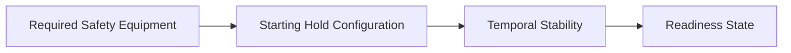

The system produces one of two final states:

```text
READY
```

or

```text
NOT READY
```

---
<br>

# Datasets

Two project-specific datasets were prepared for model fine-tuning.

## Hold Detection Dataset

The climbing-wall dataset was **collected manually at the Pakistan Sports Board (PSB), Islamabad**. High-resolution images of the climbing wall were captured specifically for this project and subsequently annotated for starting-hold detection.

The climbing-wall dataset contains **55 high-resolution images** annotated for starting-hold detection.

| Property        | Details                       |
| --------------- | ----------------------------- |
| Images          | 55                            |
| Classes         | `hold_large`, `hold_small`    |
| Annotation Type | Bounding boxes                |
| Annotation Tool | Roboflow                      |
| Model           | YOLOv8n                       |
| Training        | Fine-tuned on project dataset |

<br>

<p align="center">
  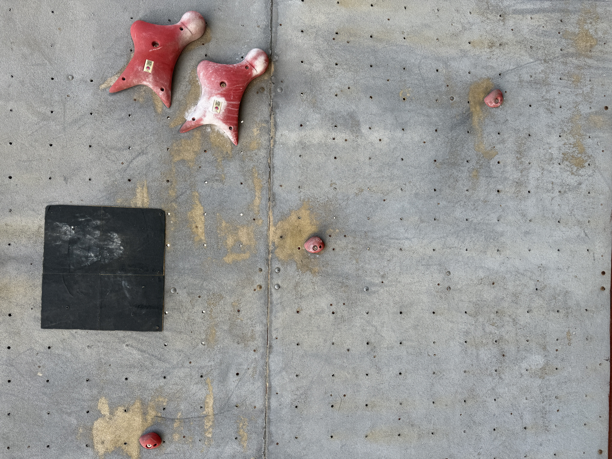
</p>

<p align="center"><em>Figure: Examples from the climbing-wall dataset used for fine-tuning the YOLOv8n hold detector.</em></p>
<br>

### Hold Annotation

The climbing-wall images were manually annotated using Roboflow.

Each relevant hold was assigned to one of the two classes:

* `hold_large`
* `hold_small`

<br>
<p align="center">
  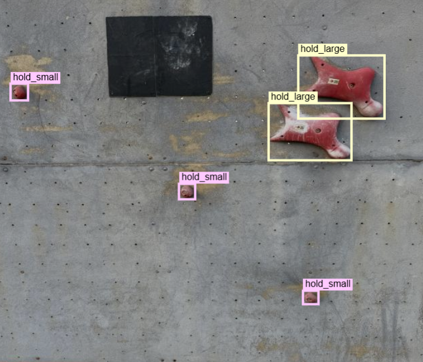
</p>

<p align="center"><em>Figure: Manual annotation of climbing holds using the Roboflow annotation workflow.</em></p>

---
<br>

## Safety Equipment Dataset

The safety-equipment dataset was **collected from publicly available speed-climbing competition videos on YouTube**. Relevant video frames were extracted and manually annotated to create the project-specific training dataset.

| Property            |                                Details |
| ------------------- | -------------------------------------: |
| Total Images        |                                    672 |
| Training            |                                    597 |
| Validation          |                                      5 |
| Test                |                                     25 |
| Classes             |                  Person, Rope, Harness |
| Annotation          | Bounding boxes + segmentation polygons |
| Training Image Size |                                 960 px |
| Annotation Tool     |                               Roboflow |
| Model               |                           YOLOv11n-seg |
| Training            |          Fine-tuned on project dataset |

<br>
<p align="center">
  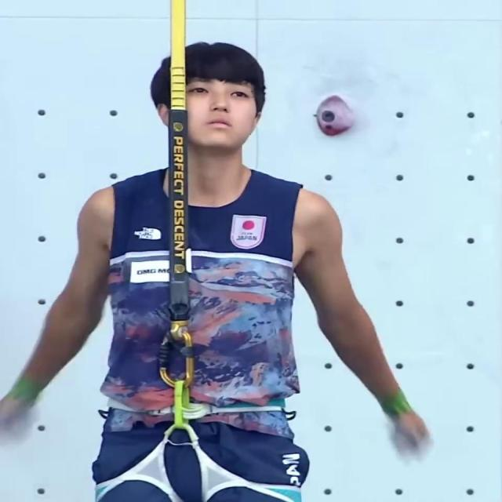
</p>

<p align="center"><em>Figure: Examples from the safety-equipment dataset used for fine-tuning the YOLOv11n-seg model.</em></p>
<br>

### Equipment Annotation

Competition frames were manually annotated for:

* Rope

* Harness

Rope and Harness regions were annotated using segmentation polygons.
<br>
<p align="center">
  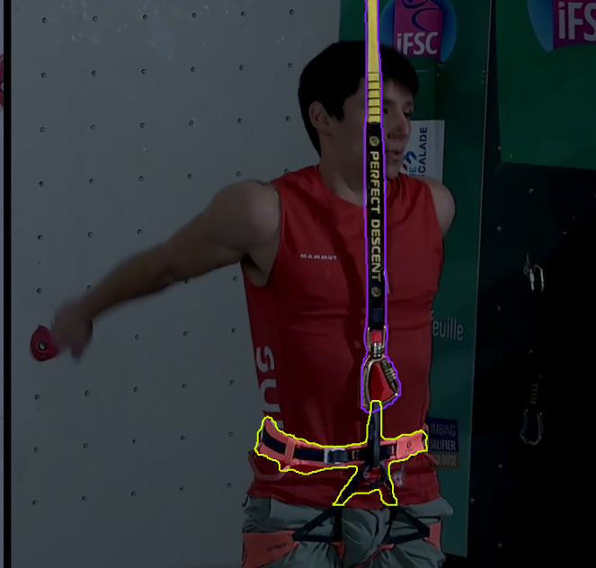
</p>

<p align="center"><em>Figure: Manual annotation of Rope, and Harness regions using Roboflow.</em></p>

---
<br>

# Annotation Workflow

The project datasets were manually prepared and annotated using Roboflow.

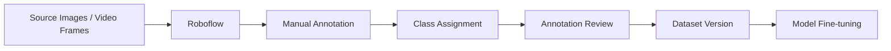

The general workflow consisted of:

1. Collecting source images and video frames.

2. Uploading the data to Roboflow.

3. Manually annotating the required objects.

4. Assigning class labels.

5. Reviewing the annotations.

6. Creating the dataset version.

7. Using the dataset to fine-tune the selected YOLO models.

---
<br>

# Models

The project uses different models for different computer-vision tasks.

| Component        | Model          | Training                                |
| ---------------- | -------------- | --------------------------------------- |
| Person Detection | YOLOv8n        | Pretrained model used directly          |
| Hold Detection   | YOLOv8n        | Fine-tuned on project hold dataset      |
| Safety Equipment | YOLOv11n-seg   | Fine-tuned on project equipment dataset |
| Pose Estimation  | MediaPipe Pose | Pretrained pose-estimation model        |

## Model Roles

### YOLOv8n — Person Detection

The standard pretrained YOLOv8n model is used directly to locate the person within the camera frame.

No project-specific fine-tuning is performed for this detection stage.

### YOLOv8n — Hold Detection

A YOLOv8n model is fine-tuned using the project's climbing-wall dataset.

It detects:

* `hold_large`
* `hold_small`

### YOLOv11n-seg — Safety Equipment

A YOLOv11n-seg model is fine-tuned using the project's safety-equipment dataset.

It detects and segments:

* `Rope`
* `Harness`

### MediaPipe Pose

MediaPipe Pose is used to obtain human body landmarks required by the geometric starting-position verification stage.

---
<br>

# Model Training Results

## Fine-tuned YOLOv8n Hold Detection Model

The YOLOv8n hold detector was fine-tuned using the project-specific climbing-wall dataset.
<br>
<p align="center">
  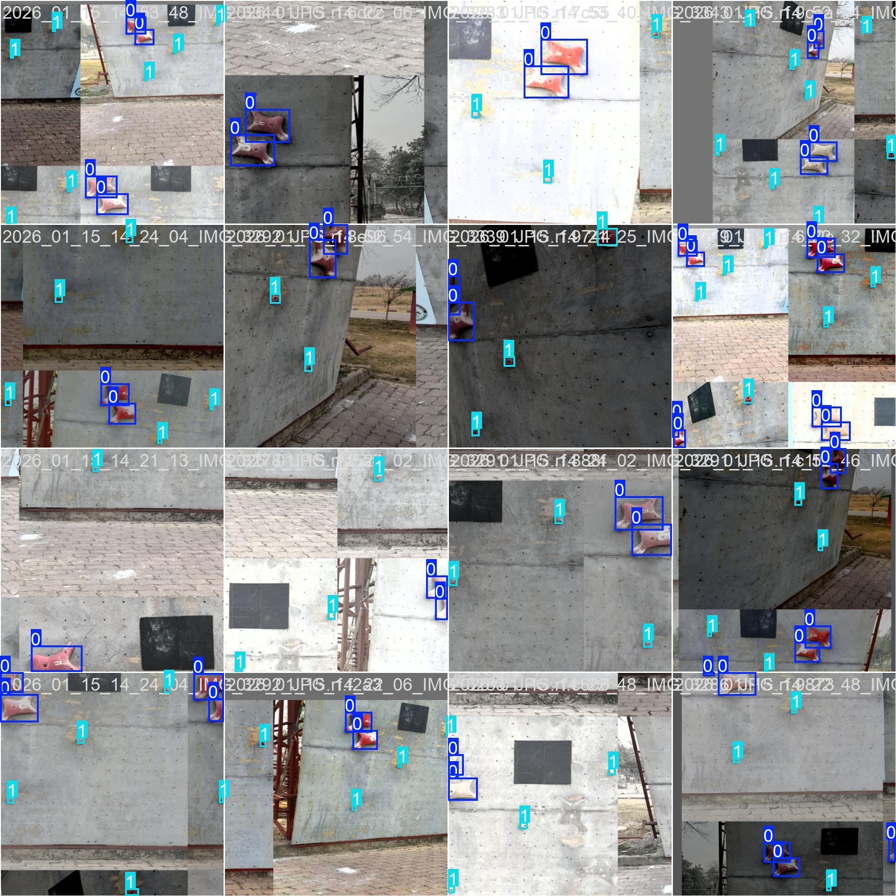
</p>

<p align="center"><em>Figure: Training results of the YOLOv8n model fine-tuned for climbing-hold detection.</em></p>
<br>

### Hold Model Metrics
<br>
<p align="center">
  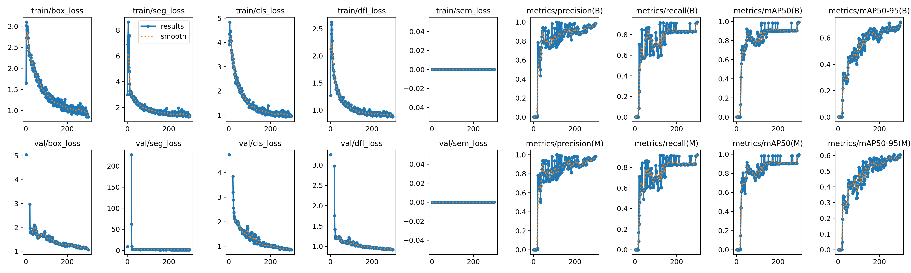
</p>

<p align="center"><em>Figure: Evaluation metrics of the fine-tuned YOLOv8n hold-detection model.</em></p>
<br>

### Hold Confusion Matrix
<br>
<p align="center">
  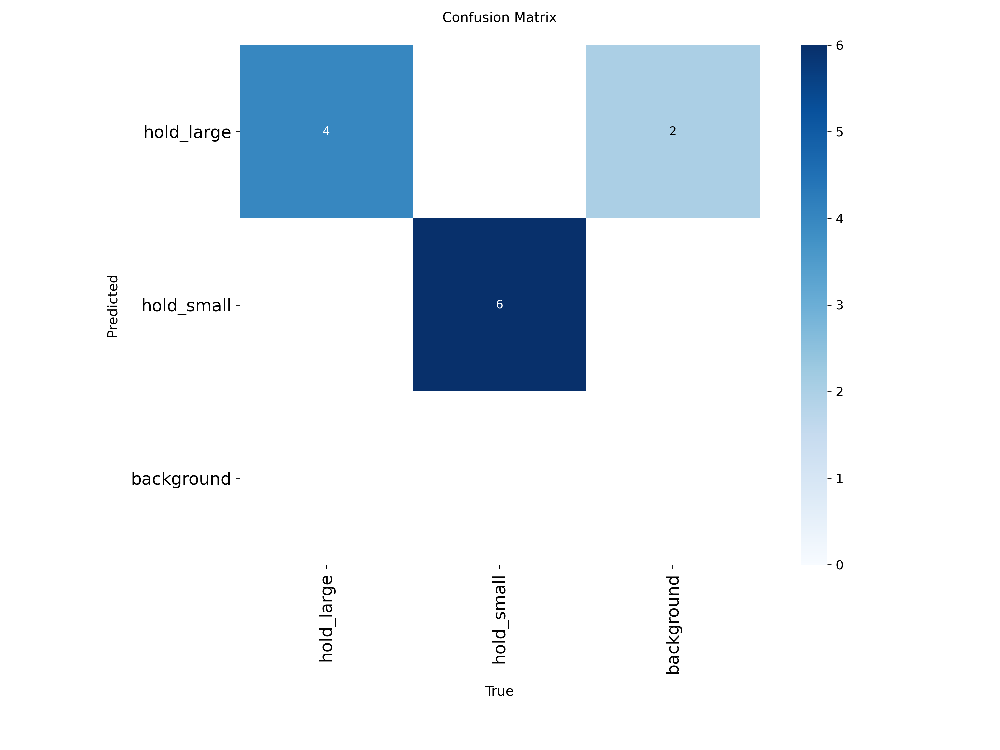
</p>

<p align="center"><em>Figure: Confusion matrix of the fine-tuned YOLOv8n hold-detection model.</em></p>

---
<br>

## Fine-tuned YOLOv11n-seg Safety Equipment Model

The YOLOv11n-seg model was fine-tuned using the project-specific safety-equipment dataset.

The model identifies and segments:

* Rope

* Harness
<br>
<p align="center">
  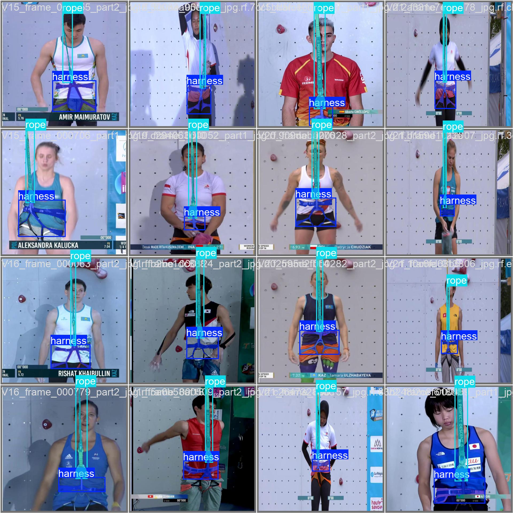
</p>

<p align="center"><em>Figure: Training results of the YOLOv11n-seg model fine-tuned for safety-equipment detection and segmentation.</em></p>
<br>

### Equipment Model Metrics
<br>
<p align="center">
  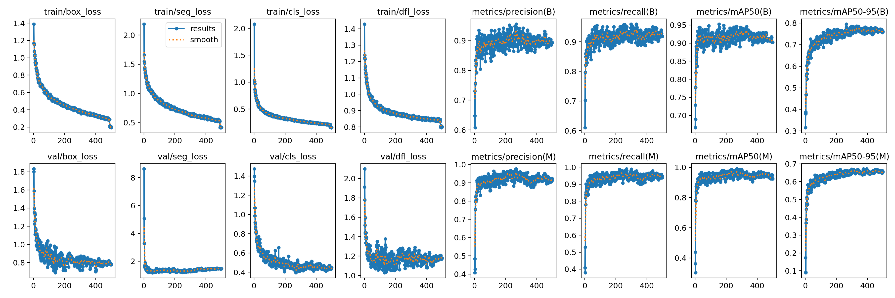
</p>

<p align="center"><em>Figure: Evaluation metrics of the fine-tuned YOLOv11n-seg safety-equipment model.</em></p>
<br>

### Equipment Confusion Matrix
<br>
<p align="center">
  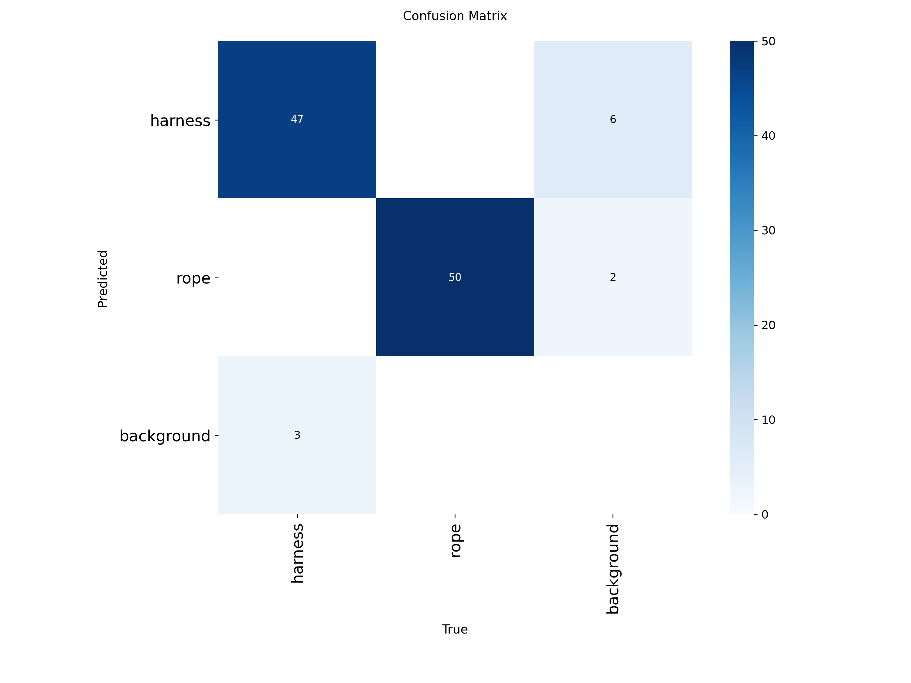
</p>

<p align="center"><em>Figure: Confusion matrix of the fine-tuned YOLOv11n-seg safety-equipment model.</em></p>


---
<br>

# Dashboard

The system includes a React-based dashboard for displaying the output of the computer-vision pipeline.

The dashboard provides visual feedback from the detection, pose-estimation, equipment-verification, and readiness-analysis stages.

<br>
<p align="center">
  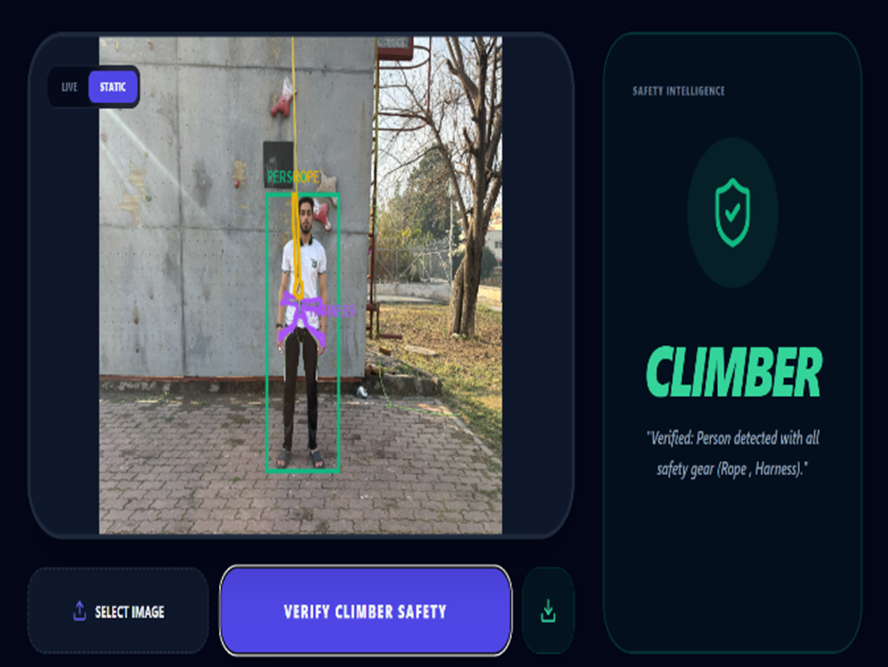
</p>

<p align="center"><em>Figure: React dashboard displaying the real-time outputs of the climber readiness detection system.</em></p>

---
<br>

# Live Testing

The complete system was tested in real time on a personal computer using live camera input.

The following demonstration shows the implemented pipeline operating on live camera input, including person detection, pose estimation, hold detection, safety-equipment verification, and the final `READY` state.
<br>
<p align="center">
  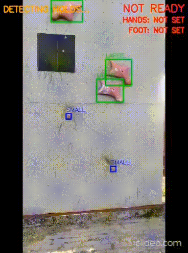
</p>

<p align="center"><em>Figure: Real-time demonstration of the implemented climber readiness detection pipeline using live camera input.</em></p>

---
<br>

# Technology Stack

## Computer Vision

* YOLOv8n
* YOLOv11n-seg
* MediaPipe Pose
* OpenCV
* PyTorch
* Ultralytics
<br>

## Backend

* Python
* FastAPI
* Uvicorn
<br>

## Frontend

* React
* JavaScript
* Tailwind CSS
<br>

## Dataset and Training

* Roboflow
* Jupyter Notebook
* CUDA

---
<br>

# Repository Structure

```text
Automated-Real-Time-Climber-Readiness-Detection/

│
├── README.md
├── assets/
├── backend/
└── frontend/
```

---
<br>

# Limitations

The current implementation is designed for a single climber and a controlled camera configuration.

System performance may be affected by:

* Rope visibility
* Harness visibility

---
<br>

# Future Work

Potential future extensions include:

* Multi-lane speed-climbing support
* Improved robustness under varying lighting conditions
* Integration with competition timing systems
* Mobile or coaching applications


---
<br>

# Author

**Mir Abu Huraira Faiz**

Department of Computer Science
National University of Modern Languages (NUML), Islamabad, Pakistan

---
<br>

# Project Information

**Degree:** Bachelor of Science in Artificial Intelligence

**Institution:** National University of Modern Languages (NUML), Islamabad

**Project Type:** Final Year Project

**Date:** September 2026

---
<br>

# License

This project is intended for academic and research purposes.
